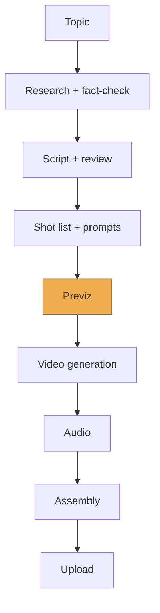

# Historical AI Video Generator — Architecture

Last updated: 2026-08-20

Fast overview of the system. For detail, see the linked docs below rather than this file — this one is meant to stay short enough to read in a couple of minutes.

- Stage-by-stage behavior: [pipeline.md](./pipeline.md)
- Why specific choices were made: [decisions/](./decisions)
- YouTube monetization policy research: [research/youtube-monetization-policy.md](./research/youtube-monetization-policy.md)
- Research-stage model comparison: [research/model-comparison.md](./research/model-comparison.md)
- Short-form format selection research: [research/short-form-format-selection.md](./research/short-form-format-selection.md)
- Horror content best practices research: [research/horror-content-best-practices.md](./research/horror-content-best-practices.md)
- Creative/narrative techniques: [playbook/narrative-techniques.md](./playbook/narrative-techniques.md)
- Human input design + the real AI-video tool landscape: [playbook/human-input-and-tools.md](./playbook/human-input-and-tools.md)
- Observed image/video failure modes and what's been tried: [playbook/failure-taxonomy.md](./playbook/failure-taxonomy.md)
- Manual pipeline dry runs: [dry-runs/](./dry-runs)

## Vision

A pipeline that turns a scene idea into a finished, YouTube-ready video, with different models handling different stages (research, narrative, visual prompting, generation), and a human review gate before every step that costs real money. The goal isn't just "software that produces a video" — it's software that produces something worth watching, with a floor of quality that holds even on video one, and that improves over time the way a creator's channel improves with experience.

**The goal is videos worth watching, not historical accuracy for its own sake** — see [decisions/0031](./decisions/0031-goal-is-quality-video-not-historical-accuracy.md). Historical settings are what the pipeline has been built and tested against so far, and research/fact-check stay genuinely useful for the parts of a scene meant to be real, but which genres are actually worth specializing in is meant to be discovered empirically across many kinds of scenes, not assumed from the pipeline's own name or its historical-genre-heavy implementation history.

Two constraints shape everything else: YouTube's monetization policy makes mass-produced, templated AI video ineligible for monetization (see the research doc linked above for what this actually says), and full ad monetization has audience thresholds (subscribers, watch hours or Shorts views) that no amount of pipeline quality can shortcut. The pipeline can get the content right; it can't skip the runway.

## Design principles

Every stage that produces cheap output (text, a still image) happens before every stage that produces expensive output (a generated video clip). Video generation is the last thing that happens in the pipeline, only after everything upstream of it has been reviewed and approved.

Every stage produces a reviewable artifact — a prompt, a document, an image — not just an opaque intermediate result. You should always be able to see and approve what a model is about to hand to the next stage.

Most stages get two passes: a generation pass (one model produces the artifact) and a review pass (a second model critiques it against explicit criteria) before it reaches you. The second model isn't rubber-stamping the first — it should be prompted adversarially, i.e. "find what's wrong with this," not "confirm this is fine."

The system should get better with use. Findings from your own review notes and, later, from actual YouTube performance data should feed back into the prompts and rubrics used at each gate, not just live in your head.

Format, audio style, and point of view are all decided per video at the narrative stage, not hardcoded as pipeline defaults — forcing every video into the same shape would itself be the "templated" pattern the monetization policy penalizes.

## Current v1 scope

The full pipeline below is the vision, and it hasn't changed. What's actually being built right now is deliberately narrower: stages 1–3 (input, research, fact-check) feeding a scoped-down Previz that produces a single image from a single described scene — no multi-scene script, no video yet. See [decisions/0006](./decisions/0006-narrow-v1-scope-single-image.md) for why, and exactly what's deferred vs. skipped for good.

## Structure

The highlighted box (Previz) is the spend gate: everything before it is text or a still image and cheap to redo; everything from Video generation onward costs real money, so nothing crosses that line without explicit approval. Full behavior of each box is in [pipeline.md](./pipeline.md).

## Open questions (not yet decided)

**Video generation model.** Needs to support image-to-video conditioning (see the Previz stage). `openai/sora-2` is the current v1 placeholder ([decisions/0010](./decisions/0010-video-generation-model-and-standalone-stage.md)) — not a rigorously compared decision, same status as previz's own image model below. Veo (Google, via Vertex AI) is the next candidate to actually compare it against; Kling and Runway remain untried. **Deadline, not just a someday comparison:** confirmed directly against OpenAI's own deprecations page (2026-09-01) — `sora-2`, `sora-2-pro`, and the whole Videos API are being removed from the API on **2026-09-24**, with no OpenAI-recommended replacement listed. `video_generation.py` must move off Sora before then; deliberately not prioritized ahead of other in-progress work (Sean's call), but this needs to happen before the shutdown date, not whenever convenient.

Now a stronger reason to specifically evaluate Runway when this comparison happens, not just leave it as one untried option among several: `docs/playbook/failure-taxonomy.md`'s same-location-beat-repetitiveness entry found that Runway Gen-4/4.5 has *native* prompt-driven camera-movement control (dolly/pan, explicit camera parameters, ~$0.05-0.15/sec base + camera-control surcharge) — a real, first-party feature for exactly the "camera coverage within one continuous shot" problem this project has been fighting at the previz-image level. Worth weighing whether that problem is better solved at the video-generation stage (one good previz keyframe per location, camera movement handled natively by the video model) rather than by generating multiple independent previz images per location and hoping they read as coherent coverage. Raw multi-ControlNet conditioning (depth + camera pose) was also researched as an alternative specifically at the previz-image level -- requires a new provider (not Gemini/OpenAI; e.g. Flux via Replicate, ~$0.03-0.05/image, comparable to current previz cost) -- but the video-stage-native-camera-control angle looks like the more direct fit and doesn't require adding a new image-generation provider at all.

**Image model for previz.** Needs to be cheap and fast since it's the primary quality gate. `gemini/gemini-2.5-flash-image` is the current v1 placeholder ([decisions/0011](./decisions/0011-previz-image-model-for-video-aspect-ratio-fit.md), superseding 0007's original OpenAI placeholder) — picked because its 9:16 output is a close aspect-ratio match to the video-generation stage's required size, not from a rigorous quality comparison; Kling, Runway, and a real quality bake-off against gpt-image-1-mini are all still untried.

**Control flow.** How stages actually get called in sequence and pause for review (a script vs. something more structured) — worth revisiting once stages 2–7 have real code to review. Likely AWS Step Functions, per [decisions/0004](./decisions/0004-aws-incremental-adoption.md), but not yet implemented. Answered for v1's narrowed scope as a plain CLI confirm-loop — see [decisions/0006](./decisions/0006-narrow-v1-scope-single-image.md).

**Compute for the video-generation stage.** Lambda's 15-minute execution limit doesn't fit long-running video-generation API calls. Fargate is the leading candidate but needs more research before committing — see [decisions/0004](./decisions/0004-aws-incremental-adoption.md).

**Which other AWS services get adopted, and when.** S3 (artifact storage), Secrets Manager/Parameter Store (API keys), and DynamoDB/RDS (pipeline state) were all identified as natural fits in [decisions/0004](./decisions/0004-aws-incremental-adoption.md), but deliberately not committed yet — each gets its own ADR if and when the pipeline actually needs it.

**Whether previz's "main character" stays generic or becomes fixed (a recurring "brand" character) or input-determined.** Raised in [decisions/0006](./decisions/0006-narrow-v1-scope-single-image.md); not resolved there.

**How a non-interactive caller should resolve a premise conflict.** [decisions/0008](./decisions/0008-refuse-impossible-premises.md) builds an interactive human review flow for when fact-check finds the requested scene historically impossible (offer a close alternative, let the human correct it, or stop) — but this pipeline may eventually be driven by something other than a human at a terminal, per the "Control flow" question above. There's no answer yet for how such a caller would resolve a conflict without a human to ask; `run_previz_stage`'s hard refusal is the safety net in the meantime, not a resolution mechanism.

**Whether an overall video "style/genre" preset is worth adding — the rule-application half is now answered.** Raised while researching camera/composition conventions for previz: classical continuity editing (the 180-degree rule, consistent screen direction, eyeline matches) is the right convention for a cinematic/film-like video, but genuinely wrong for other genres this project might want to produce — an influencer/vlog-style video routinely breaks those rules on purpose (jump cuts, direct-to-camera address) while relying on its own strong, well-established convention instead. Kids' content, "cute"/wholesome content, and other genres likely each have their own established trope set the same way. [decisions/0034](./decisions/0034-creative-flag-skips-historical-grounding.md) took the first step (a binary `--creative` flag), superseded by [decisions/0035](./decisions/0035-genre-and-tone-replace-binary-creative-flag.md) (`--genre`/`--tone` free text feeding scene-planning directly). [decisions/0036](./decisions/0036-genre-resolves-to-early-routing-signals.md) now answers the *mechanism* for exactly this 180-degree-rule-vs-jump-cuts-vs-other-trope-sets idea: genre-conditional rules are built reactively as named, selected rule groups keyed by a small early-resolved signal (generalizing the `requires_grounding` pattern), not inline prose exceptions, and not a full pipeline split per genre. Still genuinely open: the fuller structured-brief fields (audience, constraints-as-one-concept, deliverables) and whether per-stage *model* selection should also route on grounding/genre — both tracked as their own items, not resolved by 0036.

**Whether horror needs its own sub-genre routing, not just one shared rule set.** Raised after real horror-genre runs (`docs/playbook/failure-taxonomy.md`'s "Rule refinements are scenario-specific" entry): rules and moderation-risk patterns tuned against a domestic-interior haunting scene aren't assumed to transfer to a structurally different horror scenario (an outdoor chase, body horror, a slasher scene). Whether horror sub-types eventually warrant their own routed rule variants the way `composition_mode` already routes staged-vs-chaotic (ADR 0036) is genuinely undecided — needs real variety across multiple horror scenario types tried first, not just the domestic-interior scenes tested so far.

Once any of these is actually decided, it moves out of this list and becomes its own entry under [decisions/](./decisions).
