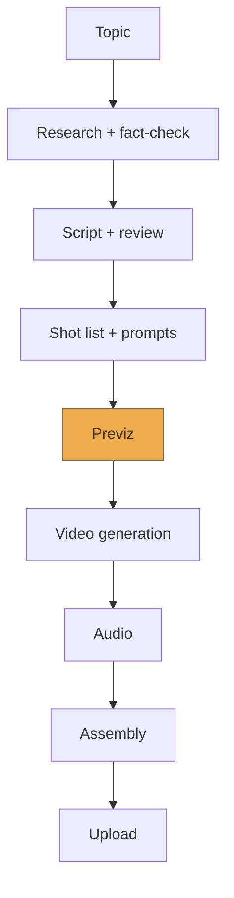

# Historical AI Video Generator — Architecture

Last updated: 2026-08-12

Fast overview of the system. For detail, see the linked docs below rather than this file — this one is meant to stay short enough to read in a couple of minutes.

- Stage-by-stage behavior: [pipeline.md](./pipeline.md)
- Why specific choices were made: [decisions/](./decisions)
- YouTube monetization policy research: [research/youtube-monetization-policy.md](./research/youtube-monetization-policy.md)
- Creative/narrative techniques: [playbook/narrative-techniques.md](./playbook/narrative-techniques.md)
- Manual pipeline dry runs: [dry-runs/](./dry-runs)

## Vision

A pipeline that turns a historical topic into a finished, YouTube-ready video, with different models handling different stages (research, narrative, visual prompting, generation), and a human review gate before every step that costs real money. The goal isn't just "software that produces a video" — it's software that produces something worth watching, with a floor of quality that holds even on video one, and that improves over time the way a creator's channel improves with experience.

Two constraints shape everything else: YouTube's monetization policy makes mass-produced, templated AI video ineligible for monetization (see the research doc linked above for what this actually says), and full ad monetization has audience thresholds (subscribers, watch hours or Shorts views) that no amount of pipeline quality can shortcut. The pipeline can get the content right; it can't skip the runway.

## Design principles

Every stage that produces cheap output (text, a still image) happens before every stage that produces expensive output (a generated video clip). Video generation is the last thing that happens in the pipeline, only after everything upstream of it has been reviewed and approved.

Every stage produces a reviewable artifact — a prompt, a document, an image — not just an opaque intermediate result. You should always be able to see and approve what a model is about to hand to the next stage.

Most stages get two passes: a generation pass (one model produces the artifact) and a review pass (a second model critiques it against explicit criteria) before it reaches you. The second model isn't rubber-stamping the first — it should be prompted adversarially, i.e. "find what's wrong with this," not "confirm this is fine."

The system should get better with use. Findings from your own review notes and, later, from actual YouTube performance data should feed back into the prompts and rubrics used at each gate, not just live in your head.

Format, audio style, and point of view are all decided per video at the narrative stage, not hardcoded as pipeline defaults — forcing every video into the same shape would itself be the "templated" pattern the monetization policy penalizes.

## Structure

The highlighted box (Previz) is the spend gate: everything before it is text or a still image and cheap to redo; everything from Video generation onward costs real money, so nothing crosses that line without explicit approval. Full behavior of each box is in [pipeline.md](./pipeline.md).

## Open questions (not yet decided)

**Video generation model.** Needs to support image-to-video conditioning (see the Previz stage). Candidates to evaluate on cost, output quality, and API access: Veo, Kling, Runway, Sora.

**Image model for previz.** Needs to be cheap and fast since it's the primary quality gate.

**Research/grounding model.** Needs real web search capability, not just training-data recall, given how much the whole pipeline depends on the fact sheet being accurate.

**Control flow.** How stages actually get called in sequence and pause for review (a script vs. something more structured) — worth revisiting once stages 2–7 have real code to review. Likely AWS Step Functions, per [decisions/0004](./decisions/0004-aws-incremental-adoption.md), but not yet implemented.

**Compute for the video-generation stage.** Lambda's 15-minute execution limit doesn't fit long-running video-generation API calls. Fargate is the leading candidate but needs more research before committing — see [decisions/0004](./decisions/0004-aws-incremental-adoption.md).

**Which other AWS services get adopted, and when.** S3 (artifact storage), Secrets Manager/Parameter Store (API keys), and DynamoDB/RDS (pipeline state) were all identified as natural fits in [decisions/0004](./decisions/0004-aws-incremental-adoption.md), but deliberately not committed yet — each gets its own ADR if and when the pipeline actually needs it.

Once any of these is actually decided, it moves out of this list and becomes its own entry under [decisions/](./decisions).
